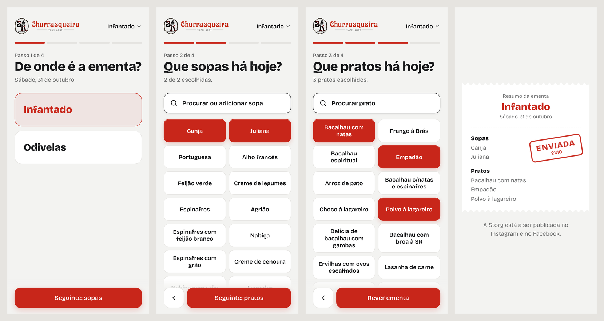
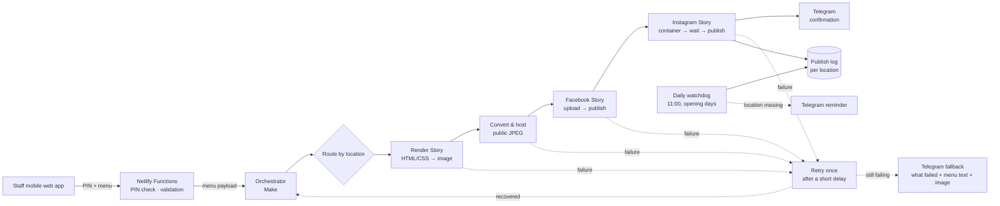
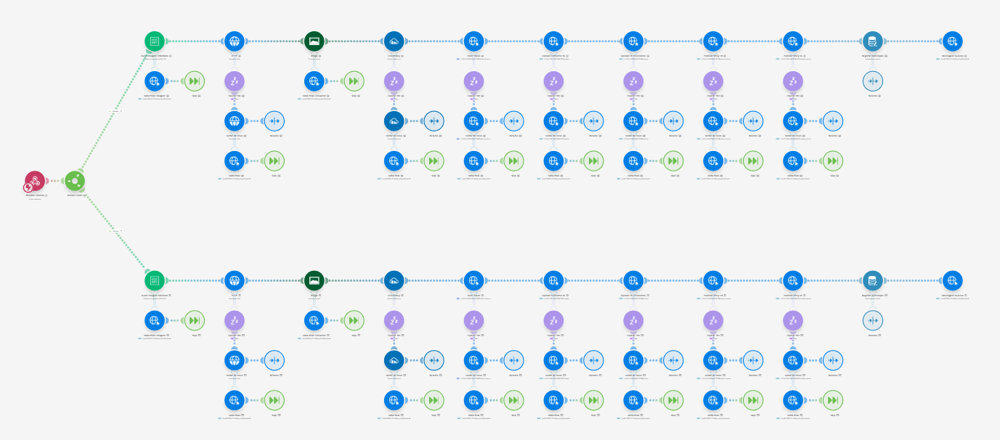
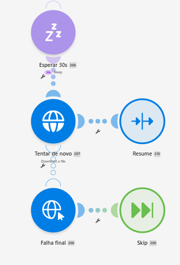

# Daily Menu → Social Stories

[](https://github.com/davidr44/daily-menu-autopublisher/actions/workflows/tests.yml)

**A production automation that turns a takeaway's daily menu into branded Instagram and Facebook Stories, published in under a minute from a staff member's phone.**

> The system is live and used every day by **Churrasqueira SR**, a family-run takeaway with two locations. This repository holds the **staff app and its serverless API** (code, tests, CI) and a **case study** of the automation behind it. The orchestration and the Story design template stay private; this page explains what they do and why each decision was made.

**Stack:** Make · Meta Graph API · HTML/CSS-to-image rendering · image CDN · Telegram Bot API · Netlify (hosting + Functions) · vanilla HTML/CSS/JS · Playwright · GitHub Actions

---

## The problem

Every morning the takeaway posts its *Ementa do Dia* (the day's soups and dishes) as a Story, one per location. Before this system it went like this:

1. The counter staff sent me the day's menu by message.
2. I fixed typos and split it into soups and dishes.
3. I edited the Canva template and exported the image.
4. I published it by hand on Facebook and on Instagram.

That was every day, for each location, and **I was the bottleneck**: if I was busy, the menu went out late or not at all.

The goal: **the people who know the menu tap a few options, and a brand-consistent Story appears on both platforms, without me in the loop.**

**Constraints I set myself**
- No new skills required from staff. If they can use WhatsApp, they can use this.
- The output must look like the existing brand design, not like a generic template.
- Running costs must stay very low (target: under about €10/month for both locations).
- When something fails, a human has to know right away, without opening a dashboard.

---

## What it does

1. **Staff open a mobile web app**, choose the location and tap the day's soups and dishes from preset lists. They can add new items too.
2. **One tap sends the menu** to an automation pipeline.
3. **The pipeline renders a 1080×1920 Story** with that location's background, phone number, typography and logo.
4. **It publishes the Story** to the brand's Facebook Page and Instagram account.
5. **A Telegram message confirms it** with the location, the time and the platforms. If a stage fails, the pipeline quietly retries it. If it still fails, one message says what broke and includes the menu text and the image, so the Story can be posted by hand in seconds.
6. **At 11:00 on opening days, a watchdog checks** that every location has published. If one hasn't, it sends a one-line reminder.

<p align="center"></p>



---

## Architecture





| Layer | Tool | Role |
|---|---|---|
| Input | Mobile-first web app on Netlify (`app/`) | Menu selection by staff, installable on the home screen |
| API | Netlify Functions (`netlify/functions/`) | PIN check, input validation, holds the webhook secret |
| Orchestration | Make | Routing, sequencing, error routes, retries, run history |
| Rendering | HTML/CSS-to-image API | Turns a branded HTML template + menu data into an image |
| Media hosting | Image CDN | Public JPEG URL that Meta can fetch |
| Publishing | Meta Graph API | Facebook Page Stories and Instagram Stories |
| State | Make data store | Last publication per location, read by the daily watchdog |
| Alerting | Telegram Bot API | Confirmations, fallbacks and reminders |

---

## Key decisions and why

### 1. A visual orchestrator instead of a custom backend
At this volume (a few runs a day), a server would be infrastructure to maintain for very little benefit. Make gives me error routes, scheduled retries, a full run history with inputs and outputs per step, and a visual flow I can reason about quickly when something breaks.
**Trade-off:** vendor lock-in and less control over low-level behaviour, such as how values are typed between steps. At this scale I accept it.

### 2. Rendering with HTML/CSS instead of a design tool's API
The original design lived in Canva. Editing it programmatically required an enterprise plan, and dedicated template-rendering SaaS products were priced for agencies, not for two takeaways. So I rebuilt the design as an HTML/CSS template and render it through an image API whose free tier fits the volume.
**Why it works:** I get pixel-level control over typography, spacing and branding, and any number of soups or dishes reflows cleanly.
**Trade-off:** design changes now mean editing a template rather than dragging boxes around.

### 3. One pipeline, many locations
Location is a field in the payload, and the pipeline routes on it. Each branch carries only what differs per location (background image, phone number), while the rendering, publishing and alerting logic stays the same. Adding a location is configuration, not a redesign. This is what makes the system sellable to other restaurants.

### 4. A conversion and hosting step before publishing
Meta doesn't accept image uploads directly in this flow. It fetches the image from a public URL, and Instagram expects JPEG. So the rendered image is converted and pushed to a CDN before any publishing step. The step looks redundant at first glance, but without it the pipeline fails.

### 5. Credentials that don't expire silently
Standard user tokens on Meta expire, and an automation that dies quietly after a few weeks is worse than no automation. I set up Meta's business-level, non-expiring credential model and derive the page-level credential at runtime, so there's no calendar reminder to "go refresh the token".

### 6. Respecting each platform's publishing model
Facebook and Instagram both publish Stories in two phases, upload and then publish, but they behave differently. Instagram processes media asynchronously, so publishing immediately after upload can occasionally fail. Instead of a fixed wait on every run, which slows down the normal case, the publish step retries after a delay only when it needs to.

### 7. Failures that end in a usable fallback, not just an alert
Nobody at a takeaway is going to check an automation dashboard, and an alert that only says "error" still leaves the job undone. So every step that calls an external service has its own error route:
- **First, a silent retry.** It waits briefly and runs the same step again. If it works, the run continues as if nothing happened.
- **If it still fails, one Telegram message.** It says which step broke and contains the day's menu as text plus the rendered image when it exists, so the Story can be posted by hand straight away. If only Instagram fails, the message says that Facebook is already live.
- **On success, one confirmation.** The message gives the location and time.

The result: one message per outcome, never a stream of retries in the chat.



### 8. A watchdog for the failure the pipeline can't see
Retries and alerts only help once a menu has been sent. The worst failure is silent: nobody sends the menu, or the request never arrives. So each successful publication writes a small record per location. At 11:00 on opening days, a separate check looks for locations without a record for today and sends a one-line reminder. Closing days and the weekly day off are excluded, so it never alerts for nothing.

### 9. Designed to run on free tiers
The whole system runs on free plans. In Make that means 1,000 operations a month, so every module has a cost. A normal publication takes about 12 operations, retries only run when something fails, and the watchdog reads both locations in a single operation. A typical month lands at around 650 operations, which leaves room for bad days.

### 10. Staff UX over feature count
Preset lists of the usual soups and dishes, large tap targets, one location picker and one send button. Access is restricted to staff. Picking from lists instead of typing also removed the typo-fixing step I used to do by hand. The fewer decisions the user has to make, the more likely the Story goes out every single day.

In October 2026 I rebuilt the app around that idea (the full history is in the commits):
- **One decision per screen.** Location, soups, dishes, review: a progress bar, one primary button in the thumb zone and a confirmation before publishing.
- **Buttons chosen from data, not guesses.** I counted 108 days of menus: 101 different dishes, about 9 per day. 20 buttons would cover 64% of what gets picked; 30 cover 77%, and 40 only add 9 points for twice the scrolling. The app shows the 30 most frequent in a fixed order (so positions become muscle memory), and search covers the long tail. Canja is preselected because it is on the menu every day.
- **Built for the phone it runs on.** Several fixes are specific to Safari on iPhone: a ghost tap that selected a location right after the PIN, the viewport panning instead of the list scrolling while the keyboard is open, the first swipe being swallowed at the edge of a scroll container. Each one is described in its commit.
- **Small things that prevent bad days.** A draft survives the app closing mid-way (15 minutes), dishes added by mistake can be deleted, and the end screen is the same receipt with a timestamped "sent" stamp, so staff see exactly what went out.

### 11. No secrets in the browser
The first version checked the PIN in the page and posted straight to the Make webhook. That was a deliberate shortcut for a tool with a very small audience: the link was shared only with two staff members, one per location, and every publication sends a Telegram message, so misuse would have been visible within seconds and the realistic worst case was unwanted Stories, not data loss. When I prepared the code to be public, that shortcut was no longer acceptable. The current version ships no secrets: two Netlify Functions check the PIN, validate the menu (known location, 1–2 soups, sensible lengths) and only then forward `{local, sopas, pratos}` to Make. PINs, the webhook URL and the webhook's API key live in environment variables, and the Make webhook rejects any request without that key, so knowing the URL alone is not enough.

---

## Things I tried and dropped

- **Editing the existing design through the design tool's API.** It was technically the most elegant option, but it was locked behind an enterprise tier.
- **Template-rendering SaaS.** They work well but cost several times my monthly budget.
- **Having an LLM API produce the design.** I discovered too late that, in that context, the API couldn't reach the design tool. The lesson I took from it: **prove the integration path end to end before spending money on it.**
- **A watchdog that counts today's Stories on the account.** It was the cheapest option, but the account also gets Stories posted by hand, so the count can't tell whether the menu went out. A per-location publish log costs a little more and gives a reliable answer.

---

## Incident: Instagram refused to publish (October 2026)

A short post-mortem, because it shows how I debug systems I don't fully control.

**Symptom.** One morning the Facebook Story published normally, but every Instagram publish attempt was rejected with *"the requested resource does not exist"*, as if the uploaded media wasn't there. The pipeline hadn't been changed in months, and it had worked the day before.

**First hypothesis, and why it was wrong.** The error message showed the media ID with thousands separators, so I suspected the orchestrator was corrupting long numeric IDs when inserting them into the request. I changed how the ID was extracted, and it still failed. The separators turned out to come from the platform's *localised error message*, not from my request. I had read the evidence too quickly.

**Getting real evidence.** I built a separate, throwaway diagnostic workflow that queried the platform directly:
- The credential was valid, non-expiring and had the publishing permission.
- The account was reachable, and the daily publishing quota was nearly unused.
- The media container the platform said "didn't exist" did exist, with status **ready to publish**.

Then I tried to publish that same ready container with the ID written in by hand, across two API versions and two credential types. Every attempt was rejected in the same way. That **ruled out my pipeline**: the platform was refusing to publish media it said was ready.

**Mitigation and outcome.** The next morning publishing worked normally again. I found a public report of the same error on Stories from another developer in the same period. The root cause on the platform side remains unknown to me. The incident did change the design, though. Every external step now retries on its own, and if that fails it hands the human a ready-to-post fallback (menu text and image) instead of a bare error.

**What I took from it**
- Confirm a hypothesis with direct evidence *before* changing production.
- Keep a diagnostic harness that can test the third-party API independently of the main pipeline.
- Treat third-party APIs as unreliable by default, and make the failure path end in something a person can act on.

---

## How I built it

I own the whole system: the process change with the staff, the Make scenario, the Story template and this app. For the October work (the retries, fallbacks and watchdog in the scenario, and the rebuild of this app) I worked with Claude (Anthropic) as a pair programmer, which is why those commits are co-authored. The product decisions were mine: which flow to keep, which buttons to show and why, what to cut, and when something was not good enough. I tested the changes on an iPhone, the same setup the staff use, and reported what broke; several of the iOS fixes above came from those sessions. Where an option was proposed, I usually asked for two or three versions as screenshots first and chose or rejected them before any code changed.

---

## The staff app in this repo

```
app/                    the single-page app (HTML, CSS and JS in one file, no build step)
netlify/functions/      /api/pin and /api/publicar
tests/unit/             tests for the functions (node:test)
tests/e2e/              Playwright tests on an iPhone-sized viewport
tests/server.mjs        local server: serves the app, runs the real functions, fakes Make
```

```bash
npm install
npm run dev     # http://127.0.0.1:4173 (test PIN: 1234)
npm test        # unit + end-to-end
```

The end-to-end tests run the real functions against a fake Make endpoint and check what Make would receive: the full publish flow, wrong PIN, the 2-soup limit, search/add/delete, draft restore and expiry, a Make outage, and that no secret ends up in the page. They run on every push (GitHub Actions).

---

## Current limitations

- **Rendering volume** is bounded by the image API's free tier. That's fine for daily menus, but it would need a paid plan at higher volume or for more locations.
- **Design changes** require editing the HTML template, not a visual editor.
- **The watchdog only knows about automated publications.** If a Story is posted by hand after a failure, the 11:00 reminder still fires for that location.
- **A 4-digit PIN is a gate for staff, not strong authentication.** It keeps the public out; it would not stop a determined attacker who can try many PINs.
- **Dependence on Meta's business setup.** Publishing relies on account linking and permissions configured on the platform, so a change on that side can break publishing without any change in the pipeline.

## Ideas for next iterations

- Poll the media's processing status before publishing, instead of relying on retry-on-failure.
- Make per-restaurant setup (branding, locations, accounts) fully configuration-driven, to onboard new clients quickly.

---

## What this project shows

- Turning a vague daily pain into a **constrained, shippable system** (cost, UX and reliability).
- **Integrating third-party APIs** with real-world quirks: asynchronous processing, media format requirements, credential lifecycles.
- **Designing for operations**, not just for the happy path: retries, fallbacks people can act on, a watchdog for silent failures, and a debugging harness.
- **Cost awareness**: the whole system fits within free tiers.
- **Honest debugging**: forming a hypothesis, being wrong, gathering evidence and isolating the fault.

---

*The Make scenario and the Story template are private because the system is in production and offered commercially. Happy to walk through them in a call.*

**Contact:** [LinkedIn](https://www.linkedin.com/in/daviddr44/) · [davidribeiro.me](https://davidribeiro.me/) · daviddr3023@gmail.com

---

© 2026 David Ribeiro. All rights reserved. This repository documents a private system and grants no licence to reproduce it.
